# X Polish

**Make X (Twitter) cleaner, smarter and more fun.** A free, private browser extension that polishes x.com and
shows you the things X already knows but doesn't display.

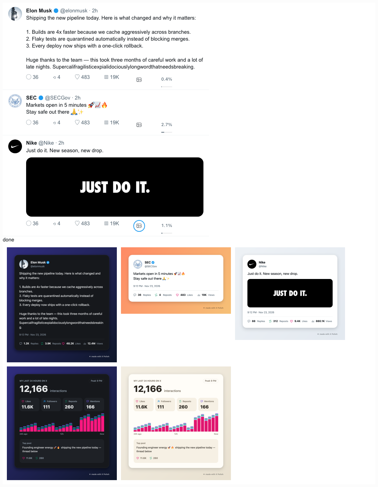

No account, no server, no tracking. Everything runs in your browser.

## Why install it

- **Share posts as gorgeous images.** One click turns any post into a polished card with six backgrounds,
  ready to copy into a chat, a slide deck or another post.
- **See your day at a glance.** A "Last 24 hours" summary sits above your notifications, and you can share it
  as an image.
- **Know who's who instantly.** Gold ring for people you follow, green for people who follow you, both for
  mutuals, plus your own colour labels for anyone.
- **Spot bots and fresh accounts.** "New · 12d" and "Possible bot" tags on replies, and account age on profiles.
- **Read the room.** A ratio meter shows every post's engagement rate, with "Hot" and "Ratioed" badges.
- **Never get spoiled.** Blur posts that mention words you choose until you click Show.
- **Focus when you need to.** Alt+Shift+F hides the sidebar, counts and clutter.
- **Live stock prices and real profiles inline.** `$NVDA` becomes a price pill; `@mentions` show the person's
  photo, name and verified badge, in posts and bios.

## Features

| | |
|---|---|
| 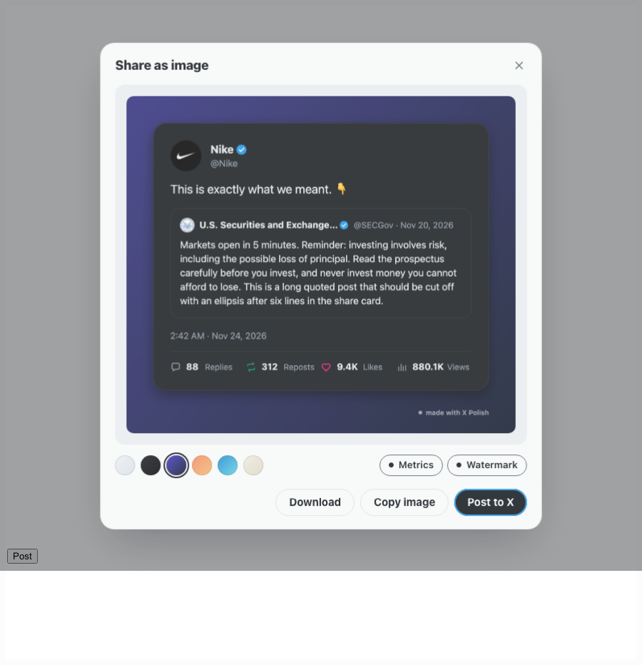 | **Share as image.** Live preview, six backgrounds (Light, Dark, Midnight, Sunset, Ocean, Paper), optional metrics and watermark, copy or download as PNG. |
| 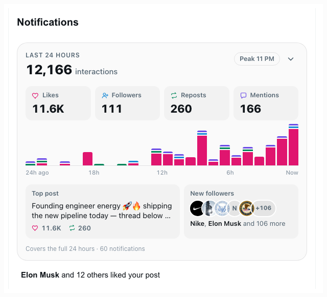 | **Notifications summary.** Likes, followers, reposts and mentions for the last 24 hours, an hourly activity chart, your top post and new followers. Cached locally, so it opens instantly. |
| 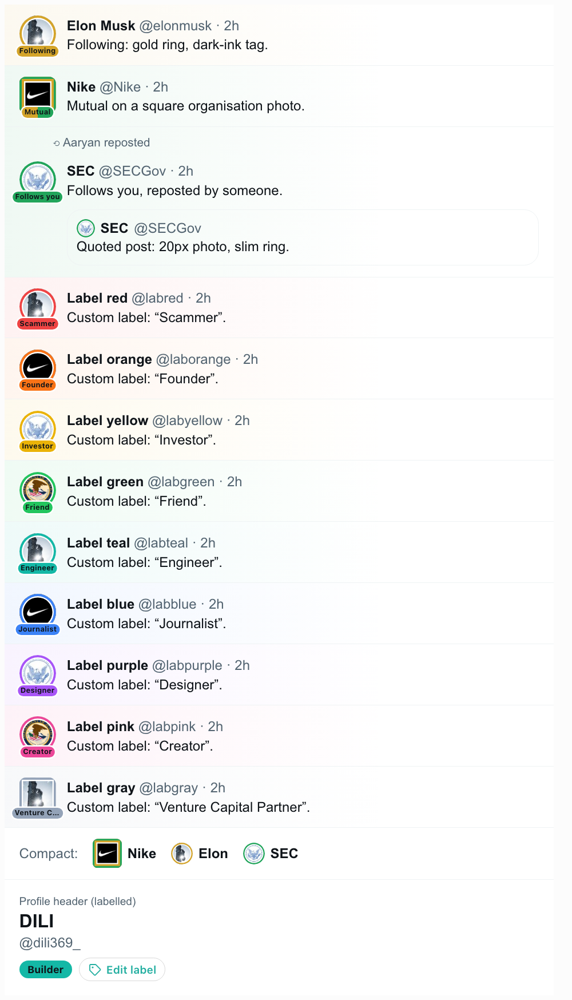 | **Follow rings and labels.** Rings and tags show your relationship with every author. Label anyone with a colour and a short tag. |
| 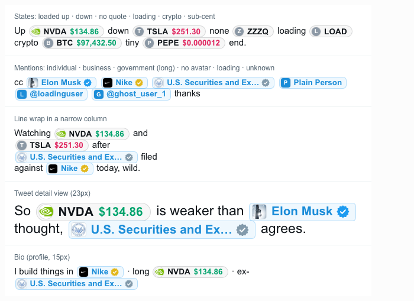 | **Stock and profile badges.** `$TICKER` pills with logo and live price; `@mention` chips with photo, name and verified badge. |
| 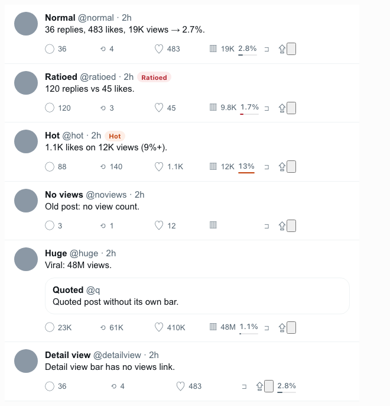 | **Ratio meter.** Engagement rate next to the view count, plus "Hot" and "Ratioed" badges. |
| 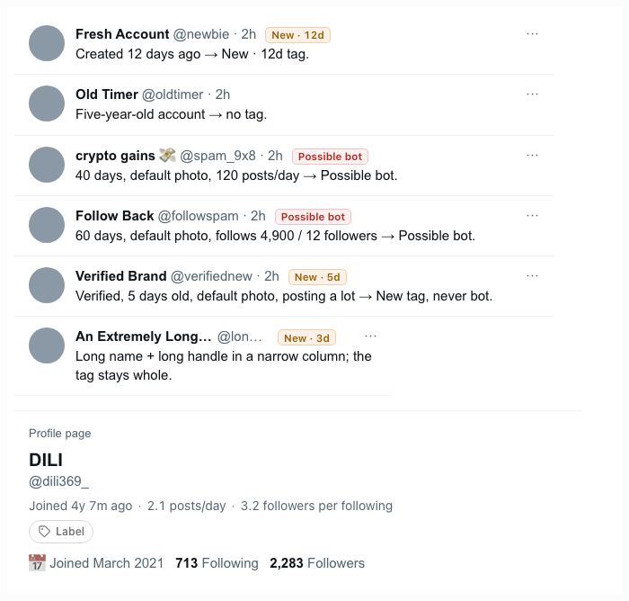 | **Account age and bot signals.** "New" tags on young accounts, "Possible bot" only when several signals stack up, and a "Joined · posts/day" line on profiles. |
| 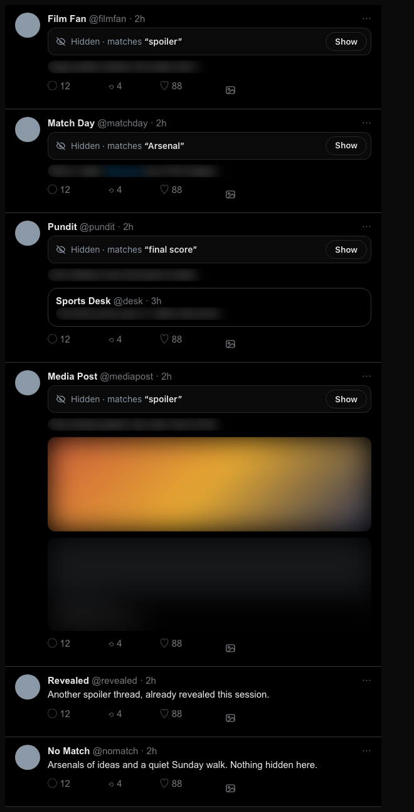 | **Spoiler shield.** Posts with your chosen words are blurred, text and media, until you click Show. |
| 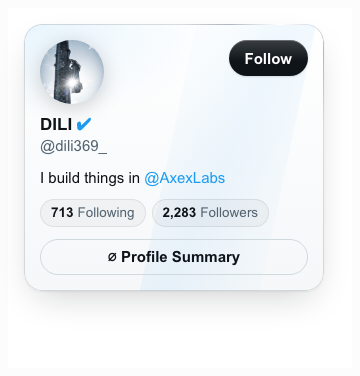 | **Polished profile hover card.** Glass surface, a thin metal edge with a slow glint, compact stats. |
| 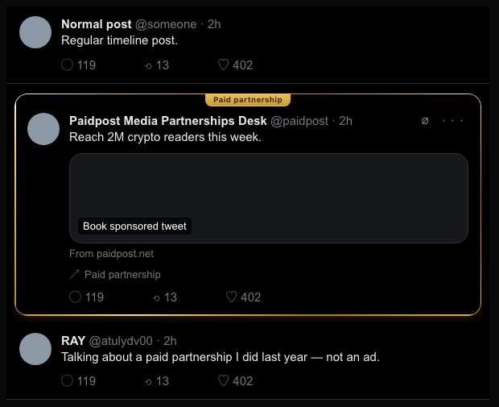 | **Paid partnerships stand out.** A thin gold ring and tag on paid partnership posts (and ads, if you let them through). |
| 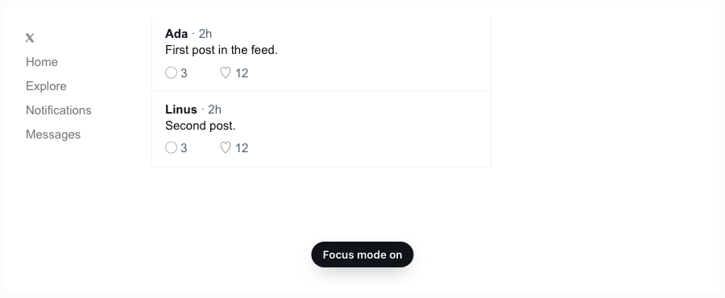 | **Focus mode.** Alt+Shift+F for a distraction-free timeline. |

Also included: ad blocking for promoted posts, trends and users; a glimmer on Community Notes; polished
sidebar boxes, composer and notifications; and a settings popup where every feature can be switched on or off.

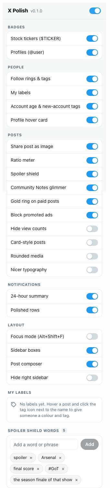

## Privacy

- Runs entirely in your browser. There is no X Polish server and no analytics.
- Reads data X already sends to your browser (follow relationships, notification details, account facts) and
  never sends it anywhere.
- Network requests: X itself (with your logged-in session, for stock prices and your notifications), X's image
  hosts (to draw share images), and as fallbacks Yahoo Finance and financialmodelingprep (stock prices and
  logos) and api.fxtwitter.com (public profile names and photos for @mentions).
- Settings and labels are stored in Chrome sync storage; notification history (last 26 hours) in local storage.

## Install

X Polish isn't on the Chrome Web Store yet. To install from source:

1. Download this repository (Code → Download ZIP) and unzip it, or `git clone https://github.com/maskjelly/x-polish`.
2. Open `chrome://extensions` and turn on **Developer mode**.
3. Click **Load unpacked** and choose the `x-polish` folder.
4. Open x.com. Click the X Polish icon in the toolbar to turn features on or off.

Works in Chrome, Edge, Brave, Arc and other Chromium browsers.

Screenshots are rendered from the extension's own code on sample data.

## Development

After editing files, click the reload icon on the extension's card in `chrome://extensions` and refresh x.com.

### Layout

```
manifest.json
src/
  background.js        network requests + caching (quotes, logos, profiles)
  labels.js            custom people labels (storage + colour palette), shared with the popup
  settings.js          toggle list + defaults (shared by popup and content script)
  page/
    adblock.js         MAIN-world filter: removes promoted entries from X's API responses
    hook.js            MAIN-world reader: follow flags, account facts, notifications (+ 24h backfill)
  content/
    selectors.js       stable X selectors (data-testid), all in one place
    xapi.js            X's internal GraphQL API (same requests x.com makes)
    api.js             content-side data layer (messages background, harvests on-page profiles)
    ads.js             DOM fallback: marks promoted tweets, trends and users
    chips.js           $cashtag and @mention badges
    hovercard.js       finds the profile hover card
    people.js          follow rings, tags, post tint, label buttons
    label-editor.js    popover for setting a person's colour + tag
    paid.js            marks "Paid partnership" posts
    notif-summary.js   "Last 24 hours" notifications panel (cached in local storage)
    share.js           share a post / the 24h summary as a PNG image
    ratio.js           engagement-rate meter, Hot / Ratioed badges
    accounts.js        account age, New and Possible bot tags, profile line
    shield.js          spoiler shield (blur posts matching your words)
    focus.js           focus mode shortcut (Alt+Shift+F) and toast
    surfaces.js        marks sidebar boxes, the composer, notification rows; tracks the current page
    dom.js             shared helpers (find the element that draws a box, mark it)
    content.js         applies settings as <html> classes, tags tweets as they load
  styles/
    base.css           design tokens (radius, colors, fonts) + layout tweaks
    tweets.css         tweet styling
    chips.css          badge styling
    hovercard.css      profile hover card styling (also defines the shared metal/glass tokens)
    people.css         rings, tags, tint, label editor
    surfaces.css       sidebar boxes, post composer, notifications (flat, hairline style)
    notif-summary.css  notifications summary panel
    share.css          share button and modal
    ratio.css          ratio meter
    accounts.css       account tags and profile line
    shield.css         spoiler shield overlay
    focus.css          focus mode
  popup/               toolbar popup, built from settings.js
icons/
```

### How it works

- Every setting becomes a class on `<html>`: `xp-<key>` (e.g. `xp-tweetCards`). CSS rules are scoped
  under those classes, so toggling is instant and needs no reload.
- Each tweet gets `data-xp-tweet` (plus `data-xp-media`), and promoted tweets / trends / users are marked with
  `data-xp-ad` (on the cell or row) for CSS to hide. Ads are also filtered from X's API, see below.
  Never add classes to X's own elements: X's React code rewrites `class` on hover and wipes them.
  Per-tweet JS goes in `processTweet()` in `content.js`.

### Ads

X serves Promoted tweets, trends and users from its own GraphQL API, mixed into normal timeline payloads,
so domain blocklists never touch them. `src/page/adblock.js` runs in the page's MAIN world at
`document_start` and wraps `fetch`/XHR. Responses are scanned for X's ad markers — an `entryId` starting
with `promoted`, a `promotedMetadata` object, or `__typename: "PromotedTweet"` — and those entries are
dropped before X's client can render them. Everything else passes through untouched.

The **Block ads (Promoted)** toggle (default on) is mirrored as `xp-blockAds` on `<html>`; turning it off
lets responses through unmodified. `src/content/ads.js` is the DOM fallback: it labels promoted
trends/users (and any ad that still renders) with `data-xp-ad`, which CSS hides instantly.

### Badges

- `$TICKER` becomes a round pill with logo, ticker and live price (green up / red down, hover for % change).
  Prices + logos come from X itself (`smartTagHoverCardQuery`, the same request as X's cashtag hover card),
  sent from the x.com tab with your session. If that fails (logged out, rate limited, X changed the query id
  in `src/content/xapi.js`), it falls back to Yahoo Finance + financialmodelingprep via the background worker.
- `@user` becomes a square chip with avatar, display name and verified badge (blue / gold / grey).
  Profiles come from tweets already on the page first, otherwise from api.fxtwitter.com.
- All network calls go through `src/background.js` (x.com's CSP blocks them from the page) and are cached:
  prices 1 min, profiles 6 h, logos 7 days.

### Profile hover card

`src/content/hovercard.js` finds X's profile hover card (classic `data-testid="HoverCard"` or the new client's
Base UI popup) and marks the box that paints it with `data-xp-hovercard`. `src/styles/hovercard.css` adds the
brushed-metal border (rotating conic gradient masked to a ring), a one-time light sweep on open, a glass body,
stat pills and glossy buttons. Cashtag hover cards are left alone.

### People: follow rings and labels

- Avatar ring everywhere: gold = you follow them, green = they follow you, gold inside green = mutual.
- Tweets get a small "Follows you" tag on the ring and a faint tint in the same colour.
- Your own labels (colour + optional tag) override the follow colours. Set them from the tag icon that
  appears next to the name when you hover a post, or the "Label" button on a profile. Manage them in the popup.
- Relationship flags come from X's own API responses, read by `src/page/hook.js` (page world). Labels are
  stored in `chrome.storage.sync` as `lbl:<handle>`.

### Adding a feature

1. Add an entry to `XP_SETTINGS` in `src/settings.js`
2. Write CSS under `:root.xp-<yourKey>` (and/or JS in `processTweet`)
